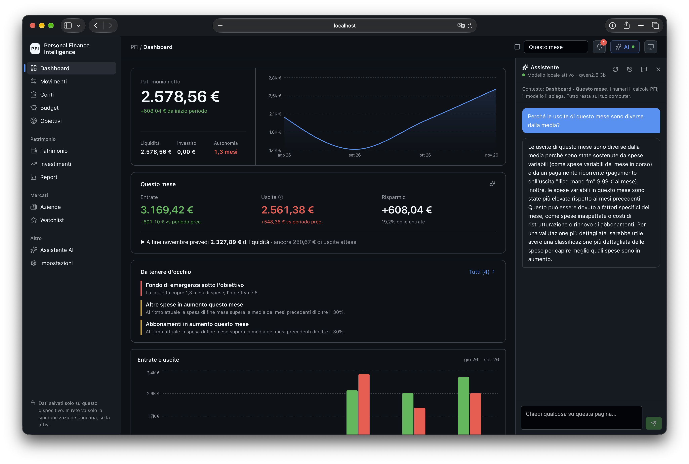

# PFI – Personal Finance Intelligence

App di finanza personale **local-first**: niente server, niente account. I dati restano nel browser (IndexedDB) e l'app funziona offline come PWA.



## Avvio

```bash
npm install
npm run dev        # http://localhost:5173
npm run build      # build statica in dist/
```

Requisiti: Node.js 20+.

## Cosa fa

- **Conti e movimenti**: inserimento manuale o import di estratti CSV, XLSX e PDF. I duplicati vengono riconosciuti.
- **Uscite = spese reali**: non contano né i giroconti tra i tuoi conti né gli acquisti di titoli.
- **Dashboard**: patrimonio netto, liquidità, investito, mese in corso e previsione di fine mese.
- **Budget, obiettivi, movimenti pianificati, patrimonio** (anche auto e beni fisici), **report** in CSV, JSON e PDF.
- **Collegamento bancario** in sola lettura con [Enable Banking](https://enablebanking.com) (facoltativo).
- **Assistente AI locale** con [Ollama](https://ollama.com) (facoltativo). I numeri li calcola l'app, il modello li spiega.
- **Analisi aziende** (facoltativo): bilanci, valutazione, DCF e report. Fonti gratuite: SEC EDGAR, Finnhub, Alpha Vantage, Tiingo.
- Backup JSON con checksum, tema chiaro e scuro.

## Funzioni facoltative

### Bridge locale (banca e dati di mercato)

```bash
cp bridge/config.example.json bridge/config.json   # compila le chiavi
npm run bridge                                     # 127.0.0.1:8787
```

Le chiavi e il `.pem` restano sul tuo computer: `bridge/config.json` e i file `*.pem` sono esclusi da git.

- **Banca**: crea un'app su Enable Banking. Indica `applicationId` e `privateKeyPath` in `config.json`, e usa come redirect `https://localhost/pfi-callback`.
- **Mercati**: compila la sezione `research`:
  - `secUserAgent` (nome ed email);
  - `finnhubKey`;
  - `alphaVantageKey`;
  - `tiingoKey`.

  Ognuna è facoltativa.

### AI

```bash
ollama pull qwen2.5:3b
```

## Test

```bash
npm test           # unit test (Vitest)
npm run test:e2e   # end-to-end (Playwright, dopo npm run build)
```

## Note

- I dati non sono cifrati dall'app: proteggi il dispositivo e fai backup regolari.
- L'app è solo informativa: non è consulenza finanziaria.
